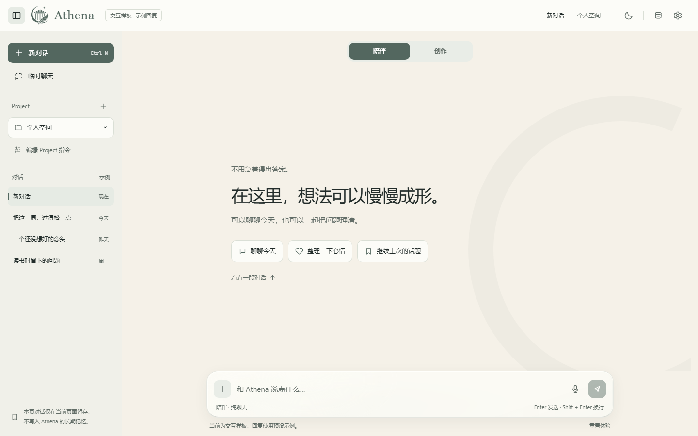
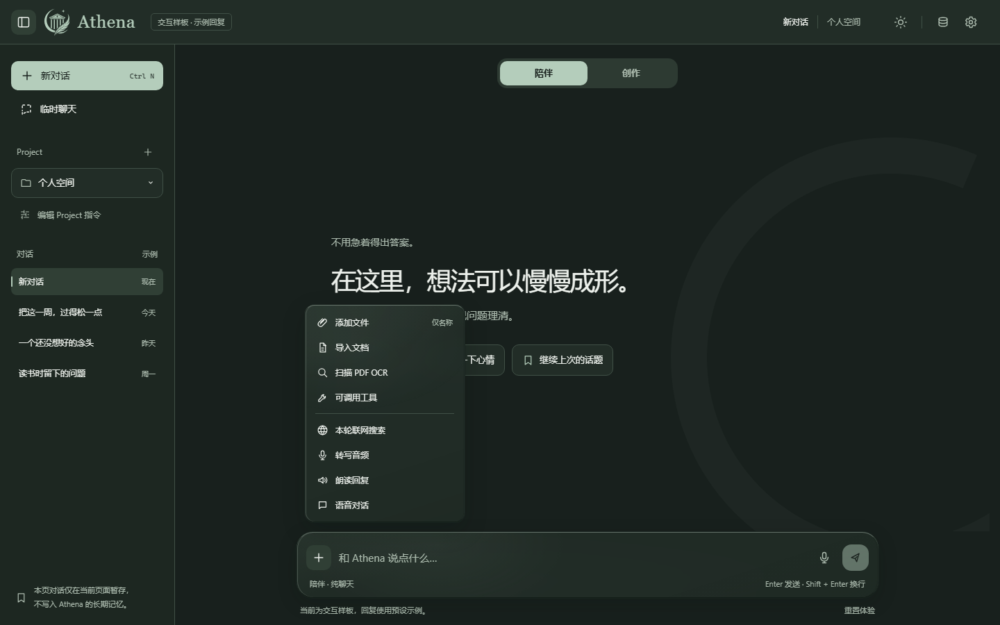

# Athena 陪伴界面交互样板

这是基于已确定视觉方案制作的独立、可点击桌面界面样板。入口是 `index.html`，不依赖 Athena 的运行配置或数据库。

按最新主题约定，本方案是日光默认主题；现软件界面保留为经典选项，新随心桌面作为另一可选方案。三者不更换已定品牌图标。入口见 [主题与布局](http://127.0.0.1:4175/theme-presets.html)，需同时运行 `node docs/brand/serve.cjs`。这仍是方案预览，尚未改正式软件默认值或接入跨主题状态共享。

## 打开

从 `G:\Athena` 运行：

```powershell
node docs/brand/companion-prototype/serve.cjs
```

打开 [本地预览](http://127.0.0.1:4174)。服务器只监听 `127.0.0.1`，只提供本目录中的静态文件；不提供模型、文件处理或工具执行接口。

也可以在支持本地 SVG 资源的浏览器中打开 `index.html`。优先使用本地预览，以获得一致的资源加载与剪贴板行为。

## 可体验内容

- 日光 / 夜色主题过渡、液态玻璃 / 实色表面、减少动效、阅读字号。
- 侧栏平滑展开 / 收起，示例对话切换，新对话与临时聊天。
- Project 选择、新建与编辑指令，只在当前页面内暂存。
- 文本输入、Enter 发送、Shift + Enter 换行、中文输入法组合输入保护。
- 预设示例回复的生成中、停止、失败与重试状态。
- 八个加号菜单入口；工具菜单在输入框上方，保留至少 10px 间距。
- 记忆、设置、工具抽屉互斥；键盘切换标签、Esc 关闭与焦点返回。
- 回复复制、加入本页示例记忆、示例记忆确认与检索。
- 附件仅显示用户选择的文件名，不读取文件内容；语音仅展示状态，不开启麦克风。
- 创作 / 推理 / 执行提供同一套组件的模式预览；执行权限固定关闭。
- 两级导航保持锚点稳定，选中底板滑动；新消息轻量入场，旧消息不重绘。
- 阅读旧消息时保留位置，使用“回到最新消息”返回；多行输入不遮挡工具菜单和元信息。
- 输入框和浮层采用局部玻璃材质：实际背景模糊、柔和内缘、指针高光与按压反馈。无空闲持续动画；不支持或要求减少透明度时回退实底。

## 视觉资产与约定

- 暖白 `#F5F1E8`、灰绿 `#53675F`、石墨 `#222C2A`。
- 夜间以深灰绿 `#18201D` 为背景，以淡灰绿 `#B4CDBB` 表示选中与操作。
- Logo 采用已确认图形的纯路径 SVG 描摹稿，主体显示 40px。它是原型母版，尚未完成生产级手工曲线与 16/24px 光学校准。
- 功能图标使用统一 24px 网格、1.75px 圆端线条；复用项目原生 SVG 并补充基本功能符号。
- 保持已有控制语义和两级导航。IP 人物、头像与角色插画不进入界面。
- 采用 minimalist-ui 的轻量布局、文字层级与克制层次；已确认的品牌颜色、圆角与线性图标优先于技能默认参数。
- 本轮按 redesign-existing-projects 的局部升级原则补足布局让位、状态转换和玻璃材质，保留原有栈、导航语义和阅读清晰度。

资产来源和复现方式见 [ASSETS.md](assets/ASSETS.md)。

布局、动效时长、材质层次与降级约定见 [MOTION_AND_MATERIAL.md](MOTION_AND_MATERIAL.md)。玻璃是网页近似实现，不是原生系统材质或实时文字的物理折射。

## 本轮验证

2026-09-10 独立 Electron 离屏验证：**54 项通过，0 项失败，15 张截图**。最终记录以报告时间戳为准。

- 覆盖 1440×900、1280×800、960×720、390×844 的日光与夜色主题。
- 检查输入与底部状态在可视区内、横向无溢出、菜单间距、抽屉互斥、焦点返回及标签键盘行为。
- 检查示例回复完成、停止后无迟到回复、失败可重试。
- 检查快速重复开合、关闭立即 inert、两级导航锚点、草稿保留、旧消息节点保留、阅读位置保持和多行输入菜单间距。
- 检查玻璃指针 / 按压 / 退出、实色回退、减少动效，以及空闲帧计数停止。
- 检查文字对比度至少 4.5:1、启用图标控件至少 3:1，并验证减少动效。计算样式测试不代表所有高光像素的精确对比度。
- 隔离窗口没有页面错误，也没有尝试外部 HTTP / WebSocket 请求。
- 人工查看日光、夜间、窄屏和展开状态截图；修正了窄屏标题单字换行与折叠区域焦点问题。
- 浏览器原有页面不会被自动刷新，以免清除正在体验的临时对话；新版可从本地预览重新打开。

详情与运行方法见 [QA.md](QA.md)，结果见 [qa-report.json](evidence/qa-report.json)。





## 范围

此样板的回复、记忆与状态为示例，不连接本地或远程模型，不读取实际聊天、人格卡、配置或数据库。临时状态在页面刷新后清除，不改写 Athena 的真实设置。正式产品代码、安装包和应用图标均未接入本轮改动。

下一阶段可以依据样板的审阅反馈校准布局，再逐项迁移到真实 renderer；届时需单独验证与现有功能、权限和数据的兼容性。
