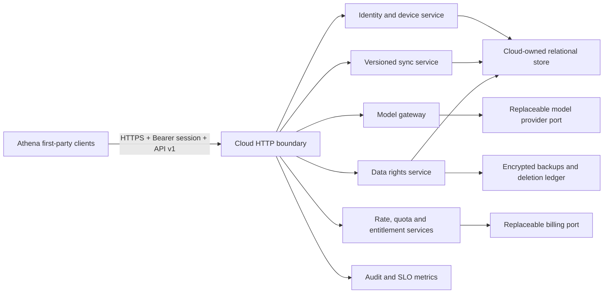

# Athena Cloud 1.0 architecture

> Window 09 / ATH-CLOUD-001. Baseline: 2026-07-16. This document describes the implemented local engineering boundary, not a production deployment.

## Boundary

The Cloud service owns its schema and package lock under `cloud/`. It does not load `src/app`, Electron IPC, `database/athena.db`, Desktop memory tables, Steamworks, terminals, arbitrary HTTP tools, local file tools, or renderer components. Clients synchronize explicitly modeled `memory`, `conversation`, `preference`, and `reminder` resources; they never upload a Desktop SQLite file or table dump.

Cloud 1.0 is intended only for Athena first-party clients. Third-party API credentials, arbitrary plugins, remote desktop control, Execute mode, arbitrary files, terminals, and computer-tool APIs are excluded.

## Components

| Component | Responsibility | Persistence |
|---|---|---|
| HTTP v1 | Strict JSON inputs, RFC 9457 problem responses, request IDs, body/time limits, no-store headers | None |
| Auth | Password hashing, TOTP MFA, one-time recovery, access/refresh rotation, device revocation | Hashes and encrypted MFA seed |
| Tenant boundary | Auth context creates `tenantId`; every object query includes tenant scope; roles default deny | Tenant and role records |
| Sync v1 | Bounded resources, version vectors, tombstones, cursors, explicit conflicts, idempotency | Encrypted resource payloads |
| Key service | Per-tenant data keys wrapped by an environment-provided master key; online re-encryption rotation | Wrapped keys and key versions |
| Model gateway | Create/Companion/Reason only, content baseline, quota, provider adapter | Counts and outcomes; no prompts/voice |
| Data rights | Authenticated export, owner-confirmed deletion, backup purge, restore denylist | Encrypted temporary export and signed ledger |
| Backup | Consistent SQLite snapshot, authenticated encryption, checksum, staging-only restore and integrity check | Encrypted local artifacts |
| Billing port | Entitlement state machine without a selected processor | Local no-charge state only |
| Deployment port | Region selection/failover interface without selected cloud | Local simulation only |

## Assets and data classification

| Class | Examples | Protection and retention |
|---|---|---|
| Restricted | Password verifier, MFA seed, session/recovery tokens, tenant keys | scrypt verifier or token hash; MFA encrypted; data keys wrapped; never logged |
| Confidential | Email, sync payload, appeal text, export, backup | AES-256-GCM with authenticated context; export expires after 24 hours; account deletion purges known artifacts |
| Internal | User/tenant/device random IDs, usage counts, audit action/outcome | Tenant scoped; audit details encrypted and chained |
| Public | API version, health status, documentation | No user data |

Prompts and voice are transient request data and are not a stored class in 1.0. The model provider receives only the prompt required for the current request. Tool logs are not accepted by the API.

## Cryptographic design

1. A 256-bit master key enters through `ATHENA_CLOUD_MASTER_KEY_BASE64`; the database never stores it.
2. Each tenant receives a random 256-bit data key. The data key is wrapped with AES-256-GCM and tenant/version associated data.
3. PII and payload encryption adds table/object identity as associated data, preventing ciphertext relocation.
4. Rotation creates a new tenant key, re-encrypts users, MFA seeds, live sync data and audit details, rebuilds the audit chain, then retires the old key version.
5. Access, refresh and recovery tokens are random and stored as SHA-256 hashes; passwords use parameterized scrypt with a unique salt.
6. Backups are separately encrypted under the environment master key and checksummed. A signed out-of-band deletion ledger is applied to every staged restore.

Production must replace the environment master-key source with a managed KMS/HSM adapter, split duties, restrict decrypt grants, enable automated rotation and retain immutable key-access logs. Local cryptography is evidence for the protocol, not evidence of production key custody.

## Replaceable external ports

- `ModelProvider`: selected only after terms, DPA, regions, retention, training use, subprocessors and deletion behavior are approved.
- `BillingAdapter`: selected only after price, currency, tax, invoice, trial, delinquency and refund policy are approved.
- `DeploymentAdapter`: selected only after cloud vendor and primary/secondary regions are approved.
- `RecoveryDeliveryAdapter`: selected only after an email or equivalent recovery provider and anti-abuse controls are approved.
- `SecretProvider`: local environment source today; production KMS/secret manager required.

The defaults are `local-fixture`, `local-no-charge`, local two-region simulation, local recovery-token return and environment secrets. They cannot create real cost.

## Production fail-closed gate

`ATHENA_CLOUD_ENV=production` refuses startup if any of these are still local or missing: TLS termination proof, master key, region, cloud provider, billing adapter, recovery delivery adapter, model provider or search provider. Startup also requires every runtime adapter ID to exactly match its reviewed configuration and exposes those bindings through `/health/ready`. This prevents an engineering fixture from being mistaken for Cloud 1.0 production.
