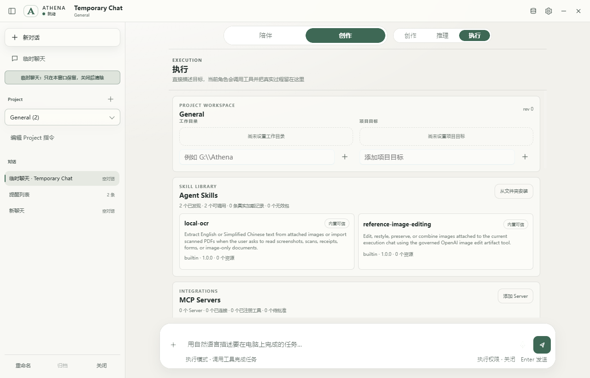
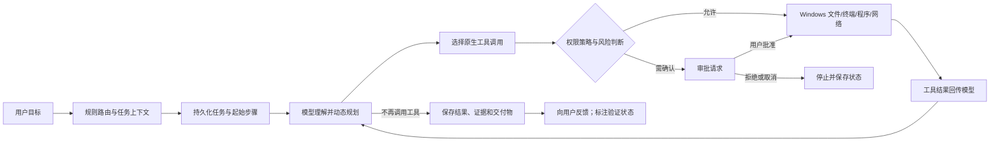
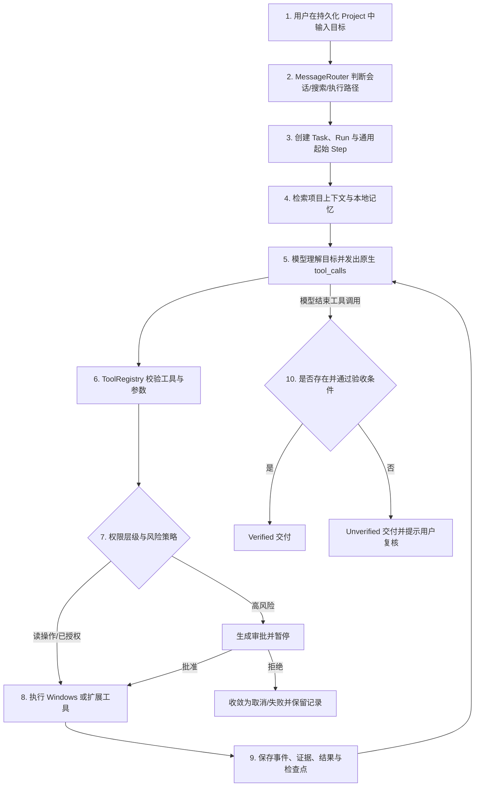
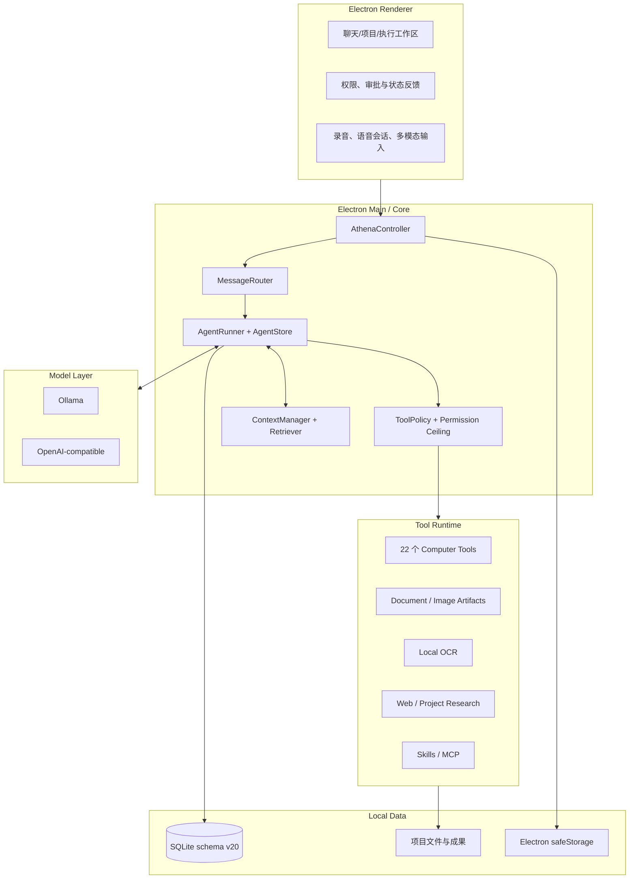
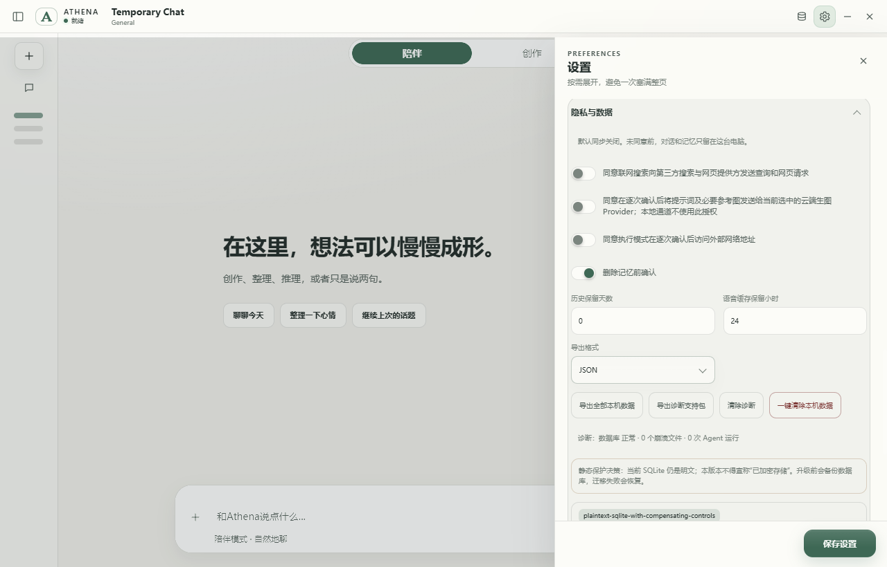

# Athena

## 本地优先的自主桌面 AI Agent

**2026 AI杭州·码动未来 AI模型智能体创新大赛**  
**AI+超级智能体赛道·高校组**

项目版本：`0.9.7-beta.1`（私测候选版）  
材料基线：2026 年 9 月 15 日当前仓库  
源码状态：`codex/ci-green-0.9.7` 相对远端 ahead 11；关键 Agent 改动已提交并通过验证，但仍有既存 Cloud 工作树改动，不是可复现发行快照  
运行平台：Windows 桌面端（Electron）

> 参赛说明：本文仅描述当前仓库中可定位到实现并经相应检查验证的能力。测试桩、源码存在、真实设备运行、签名安装包与线上服务可用性被严格区分；规划项不计入当前能力。

## 01 项目概述

Athena 是一款面向个人用户的、本地优先的 Windows 自主桌面 AI Agent。用户以自然语言说明目标后，Athena 在持久化项目空间中组织上下文，由支持原生工具调用的语言模型连续选择工具，读取或修改文件、执行命令、管理终端、启动程序、访问经授权的网络服务，并将步骤、审批、证据和交付物写入本地任务记录。它的目标不是只给出“应该怎么做”的答案，而是在用户设定的权限边界内，把可执行的工作推进到可检查的结果。

当前版本为 `0.9.7-beta.1` 私测候选版，而非公开商店版或已签名正式版。Athena 已形成真实可运行的 Agent 主链，但仍有三项必须如实限定：目前没有通用的鼠标、键盘与屏幕视觉控制；用户创建任务时只生成一个通用起始步骤，细粒度计划主要由模型在工具调用循环中动态形成；自动验收标准尚未为普通用户任务完整接入。

## 02 背景与用户痛点

传统 AI Chatbot 擅长解释、总结与生成文本，但它与真实桌面工作之间存在明显断层：AI 会告诉用户怎么做，然而创建目录、整理文件、运行脚本、检查服务、保存成果、处理失败和继续执行，仍需要用户在多个窗口之间手动完成。

个人工作流尤其容易出现四类成本：一是用户必须把目标反复翻译成软件操作；二是跨文件、跨步骤任务缺少持续状态；三是敏感操作与外部网络调用的授权边界不透明；四是对话生成的答案与最终可交付文件相互割裂。Athena 将问题定义为“如何在用户控制下让 AI 对真实环境采取动作”，而不是单纯追求更长的回答。

## 03 产品解决方案

Athena 将一次执行组织为可持续、可暂停、可恢复的任务闭环：

其中，“任务拆解”在当前版本中有两层：任务服务会创建持久化任务和通用起始步骤；模型随后在默认 16 轮模型交互、48 次工具调用的受限预算内动态决定下一步。预算耗尽时任务不会直接伪装成失败，而会暂停询问用户是否追加同等预算；用户也可选择停止并获得基于真实工具结果的总结。系统会保存任务、运行、步骤、工具事件、审批记录和交付物，支持取消、失败收敛以及部分场景下的安全重试。对于缺少显式验收条件的普通任务，系统会把结果标记为“未验证”；存在未恢复的失败或拒绝步骤时会标记为“含问题”，而不是把“模型停止调用工具”包装成已自动验收。

## 04 核心功能

### 4.1 连续 Agent 执行

- **功能是什么：** 模型不是一次性输出整份计划，而是在每轮收到工具结果后继续判断下一步，直到完成、取消、失败或达到上限。
- **解决的问题：** 让多步骤任务能够根据真实环境反馈调整，而不是只生成静态操作说明。
- **实际实现：** `src/core/agent/AgentRunner.ts` 负责原生 `tool_calls` 循环、检查点、审批、重试、恢复与结果归档；`src/core/controller/AthenaController.ts` 将其接入聊天执行入口。
- **当前成熟度：** **已实现 / Beta。** 主链与回归测试已通过；默认预算为 16 轮模型调用和 48 次工具调用，耗尽后由用户决定是否继续；细粒度可视计划和通用验收标准仍不完整。

### 4.2 Windows 计算机工具

- **功能是什么：** 提供 22 个受控工具，覆盖文件信息、目录列举、读写与检索、复制移动删除、命令执行、持久终端、程序启动、路径打开、HTTP 请求和端口检查。
- **解决的问题：** 把 AI 的判断连接到真实 Windows 文件系统和命令环境。
- **实际实现：** `ComputerToolCatalog.ts` 定义工具目录，`ComputerTools.ts` 执行，`AgentComputerTools.ts` 中的 `ComputerAgentToolBridge` 注入 Agent。
- **当前成熟度：** **已实现 / Beta。** 能操作文件、Shell 和可命令化应用；尚无通用鼠标、键盘、屏幕识别或任意 GUI 点击能力。

### 4.3 任务状态与恢复

- **功能是什么：** 项目、目标、任务、运行、步骤、审批、事件、证据和交付物写入本地数据库，执行可取消并在受控条件下恢复。
- **解决的问题：** 避免长任务只存在于一次模型响应中，便于追踪“做到了哪一步、为何停下、产生了什么”。
- **实际实现：** `AgentStore.ts`、`ProjectWorkspaceService.ts` 和数据库 schema v20；执行层写入检查点并区分 succeeded、failed、cancelled、awaiting approval 等状态。
- **当前成熟度：** **已实现。** 自动重试只面向安全或幂等工具；不确定重放需更高等级确认；模型服务中断可停在检查点并让用户选择重试或结束。

### 4.4 本地记忆与上下文

- **功能是什么：** 提供会话工作记忆、消息记录、用户事实、情景事件、每日摘要、程序性记忆审核队列、带来源的时序事实、项目笔记与项目文档索引。
- **解决的问题：** 在令牌预算内延续项目上下文，同时让长期信息可追溯、可隔离。
- **实际实现：** SQLite 本地存储；`ContextManager` 控制窗口上下文；记忆检索、日摘要、保留分层和项目隔离均有独立实现。
- **当前成熟度：** **已实现 / Beta。** 默认哈希 n-gram 检索对同义改写较弱；可选本地 Ollama 向量能力已有接口与测试，但本次未以真实本地模型做在线验证。

### 4.5 多模型与多模态

- **功能是什么：** 支持 Ollama、本地或远程 OpenAI-compatible 接口，以及 DeepSeek、Athena Cloud、自定义供应商配置；在模型能力允许时发送图像输入。
- **解决的问题：** 用户可在本地性、能力、成本与速度之间选择，不被单一模型绑定。
- **实际实现：** `LLMClient` 连接 `OllamaAdapter` 与 `OpenAICompatibleAdapter`；供应商配置和密钥由设置层管理，密钥使用 Electron `safeStorage` 加密。
- **当前成熟度：** **适配层已实现 / 服务可用性取决于配置。** 本次验证为契约与夹具测试，不代表已完成付费云模型真实调用；Athena Cloud 生产服务也不计为当前成熟能力。

### 4.6 语音交互

- **功能是什么：** 本地语音转文字、本地或 Windows 语音合成、静音自动停止、语音会话与打断。
- **解决的问题：** 在双手被占用或长文本输入不便时，通过语音发起和继续任务。
- **实际实现：** `faster-whisper` Python 运行时、本地 Piper（若随包提供）与 Windows SAPI 回退；本地运行时依赖检查通过。
- **当前成熟度：** **Beta。** 代码与运行时依赖成立，但本次未完成真实麦克风、扬声器和干净机器上的端到端录制证明。

### 4.7 文件、OCR 与成果生成

- **功能是什么：** 聊天可接收图像、文本、DOCX、XLSX 等附件；本地 OCR 可提取中英文图像文字；Agent 可生成 Markdown、HTML、DOCX、PDF 文档成果及图像类成果。
- **解决的问题：** 让输入资料和最终文件进入同一个任务链，而不是停留在聊天文本。
- **实际实现：** `AttachmentService`、`LocalOcrService`、`OcrAgentToolBridge`、`ArtifactAgentToolBridge`、`ProjectDocumentService`。
- **当前成熟度：** **部分实现 / Beta。** 图像理解取决于所选模型；当前 PDF 项目文档导入存在已登记缺陷，不能把 PDF 输入解析写成稳定能力；PDF 成果生成是独立链路，相关测试通过。

### 4.8 Skills、MCP 与研究工具

- **功能是什么：** Agent 可列出和加载受信任技能说明与资源，可接入配置化 MCP 工具，并使用网页搜索、网页研究和项目检查工具。
- **解决的问题：** 在不扩大核心权限的前提下扩展领域知识与工具接口。
- **实际实现：** `SkillAgentToolBridge.ts`、`McpIntegrationHost.ts`、`ResearchAgentToolBridge.ts` 与 `WebResearchAgent.ts`。
- **当前成熟度：** **Beta / 实验性。** Skill 只提供受信任的文本说明和资源，不自动执行技能脚本；Web 研究供应商与线上稳定性尚未达到正式版承诺水平。

## 05 超级智能体工作流程

一次完整执行链如下：

实际链路具有以下约束：Execute 模式必须显式授权模型请求，并要求持久化 Project；Create、Companion、Reason 模式不会获得计算机权限；权限分为 `off/read/files/full` 四级且默认为 `off`；外部网络另有同意开关；运行中收紧权限会同步降低当前任务的权限上限。默认执行预算为 16 轮模型调用和 48 次工具调用，预算用尽会暂停并请求用户决定是否继续，防止无界循环。

错误处理并非简单“再试一次”。系统仅对安全、幂等的工具执行自动重试；若先前执行结果不确定，恢复时需要关键等级确认，避免重复删除、重复写入或重复发起外部动作。每次工具调用结果会返回模型，模型可据此换用其他工具或解释失败。

## 06 技术架构

架构的关键不是模块数量，而是权限与状态的归属清晰：Renderer 只负责交互，不直接持有模型密钥；主进程控制模型、任务和工具；工具目录声明能力与风险；本地数据库承担可恢复状态和记忆；模型只能通过注册工具触达环境。Electron 窗口启用了 sandbox 和 context isolation，并关闭 renderer 的 Node.js 直接访问。

技术栈以 Electron、TypeScript、Vite、SQLite、`better-sqlite3` 为主；本地模型通过 Ollama，兼容云模型通过 OpenAI-compatible 协议；本地语音依赖由随包 Python 3.11、`faster-whisper`、Piper/Windows SAPI 组成。当前不是云端多租户 SaaS 架构，核心工作空间和记忆均落在用户设备。

## 07 核心创新点

### 7.1 把“回答”变成受控的环境动作

Athena 的差异不在于多一个聊天界面，而在于模型能以原生工具调用驱动文件、终端、程序与网络工具，并依据实际返回继续执行。动作经过注册目录与权限策略，而非让模型直接拥有系统访问权。

### 7.2 将 Agent 状态作为产品对象

任务、运行、步骤、审批、证据和交付物都有持久化实体。Agent 可以暂停等待授权，失败后保留上下文，取消后清理运行态；这比“把一段思维链显示在聊天框里”更接近可管理的个人自动化系统。

### 7.3 本地优先但不排斥多模型

Athena 把本地 SQLite、Ollama、本地 OCR 与本地语音作为优先路径，同时保留 OpenAI-compatible 适配。用户能够按任务敏感度选择模型，而不是被迫把所有工作数据发送给单一云服务。是否访问外部模型和网络均由设置与同意状态控制。

### 7.4 记忆不仅是聊天历史

当前数据模型区分短期上下文、长期事实、情景事件、每日摘要、程序性记忆审核和项目资料，并保存来源。虽然默认语义检索仍有限，但这种可分层、可追溯、按项目隔离的设计，为“个人长期 AI 工作环境”提供了实际基础。

### 7.5 对未验证结果保持诚实

当前系统在无验收条件时会标注 `unverified`，而非仅因模型停止调用工具就宣称任务已验证。这不是功能缺失的包装，而是将结果可信度显式纳入任务闭环；下一阶段要做的是让用户能够定义、看到并复用验收条件。

## 08 典型使用场景

### 场景一：本地资料整理与交付包生成

用户指定一个演示资料目录，要求 Athena 读取 Markdown、CSV、DOCX/XLSX 与图片资料，必要时执行 OCR，归纳需求，建立输出目录，生成项目摘要、任务清单和 PDF/DOCX 交付物，并检查结果文件是否存在。该场景能真实串联目录扫描、内容读取、OCR、文件写入、成果生成与状态记录。当前应避免把 PDF 作为输入资料，因为项目 PDF 导入缺陷尚未修复。

### 场景二：开发环境自检与诊断报告

用户要求检查某个本地服务是否启动。Athena 可读取配置、检查端口、发起 HTTP 请求、运行诊断命令、收集输出，并将发现、证据和建议保存成报告。它能够根据失败结果更换检查方式，但无法像通用 GUI Agent 一样点击任意 IDE 或弹窗。

### 场景三：受控文件归档

用户要求按扩展名或日期整理指定目录。Athena 先列出并解释拟处理对象，再调用复制或移动工具；遇到覆盖、删除等高风险动作时进入审批。当前源码会为每个待审批调用逐项展示命令、路径、URL、写入预览等关键参数，并允许逐项批准或拒绝；最终生成索引和变更摘要。比赛前仍需用真实运行截图证明 UI 与实际参数一致。

### 场景四：跨会话项目续作

用户在持久化 Project 中继续此前工作，Athena 从项目消息、笔记、记忆和文档索引中检索上下文，接续任务并保存新产物。该场景体现“长期工作环境”，但默认检索对纯同义改写的召回仍弱，适合使用明确项目关键词进行演示。

### 场景五：语音发起的本地任务

用户通过本地语音输入提出任务，Athena 转写后进入同一任务链，并用本地或 Windows TTS 反馈。该能力当前为 Beta，比赛现场必须预先在同一设备完成麦克风、模型文件与音频输出的真实验证，不能只依赖依赖检查结果。

## 09 与普通 AI 助手的区别

| 对比维度 | 普通 Chatbot | 普通桌面助手 | Athena 当前版本 |
|---|---|---|---|
| 任务理解 | 以问答与文本生成为主 | 识别少量固定指令 | 模型理解目标；入口路由默认仍以规则为主 |
| 任务规划 | 通常给出建议步骤 | 固定流程或快捷命令 | 在持久化任务中通过原生工具循环动态规划；可视细粒度计划不足 |
| 工具调用 | 常无真实工具或单次调用 | 调用预设系统能力 | 注册化多工具连续调用；默认 16 轮模型调用、48 次工具调用，预算可经用户确认追加 |
| 环境操作 | 用户手动执行 | 打开应用、设置提醒等 | 文件、Shell、终端、程序启动、路径打开、HTTP/端口；无通用 GUI 控制 |
| 上下文记忆 | 对话历史为主 | 通常较弱 | 本地多层记忆、项目隔离、来源记录；默认语义召回有限 |
| 任务连续性 | 单轮或单会话 | 固定指令完成即结束 | 持久化 task/run/step/event，支持暂停、审批、取消与受控恢复 |
| 权限控制 | 多为模型或平台级开关 | 系统授权为主 | `off/read/files/full`、远程同意、风险审批、运行中权限收紧 |
| 最终成果交付 | 主要交付文本答案 | 完成单一系统动作 | 可生成文件成果并记录证据；自动验收尚未完整接入 |

## 10 当前完成度

### 【已实现】

- Electron Windows 桌面端及执行工作区；当前源码构建与桌面 smoke 通过。
- 支持原生工具调用的连续 AgentRunner，含轮次/调用上限、检查点、事件、取消、失败与审批恢复。
- 22 个计算机工具：文件、目录、文本检索、命令、终端、程序/路径打开、HTTP 与端口检查。
- 持久化 Project、目标、任务、运行、步骤、审批、证据和交付物。
- 权限分级、默认关闭、模型请求同意、外部网络同意、运行中权限上限收紧。
- 本地 SQLite 多层记忆、项目隔离、上下文令牌预算、长期信息来源记录。
- Ollama 与 OpenAI-compatible 模型适配层，以及供应商配置和加密凭据存储。
- 常用文本、图像、DOCX、XLSX 附件；本地中英文 OCR；文档成果生成。
- Skill 文本资源、MCP 工具接入、研究工具的受控扩展框架。

### 【部分实现 / Beta】

- 动态任务规划已存在，但用户创建任务只有通用起始步骤，缺少执行前可审阅的细粒度计划。
- 结果、证据与成果已持久化，但普通任务的自动验收条件为空，结果经常应标为 `unverified`。
- 语音依赖与逻辑成立，缺少本次真实音频设备端到端证明。
- 图像理解依赖具体模型能力；云模型仅完成适配与夹具验证，不能宣称线上服务已在本次材料制作中实测。
- Web 研究可用但仍属实验性供应商路径。
- 默认记忆检索的关键词能力稳定，但对同义改写的语义召回不足。
- PDF 可作为生成成果；PDF 项目文档导入当前存在缺陷。
- 高风险动作会请求审批；当前源码已接入逐项参数展示、逐项批准/拒绝、敏感信息遮蔽和批量批准入口，但仍需要真实运行截图作为比赛证据。

### 【规划中 / 当前不计入能力】

- 通用鼠标、键盘、屏幕视觉理解和任意 Windows GUI 自动化。
- 用户可审阅、编辑并逐步确认的结构化计划。
- 面向普通任务的可配置验收标准与自动结果验证。
- 已签名公开发行包、商店上架和干净设备规模化 Beta 证明。
- Athena Cloud 生产级同步与服务承诺。
- 默认角色 Live2D 能力；当前 release feature gate 明确关闭。

## 11 安全与隐私

Athena 的安全设计以“模型不能绕过工具层直接访问环境”为核心。计算机权限分为 `off/read/files/full`，默认全部关闭；只有 Execute 模式可以获得计算机权限，Companion、Create 和 Reason 模式被强制为 `off`。模型请求需要用户同意，外部网络访问另有开关；运行过程中撤销权限会降低当前任务的权限上限。

高风险工具会进入审批并暂停运行，审批、拒绝与恢复均有持久化记录。系统对安全或幂等调用才允许自动重试，对执行结果不确定的重放要求关键等级审批。Renderer 启用 sandbox 与 context isolation，关闭 Node.js 直接访问；API 密钥不下发给 Renderer，并使用 Electron `safeStorage` 加密保存。

数据主要保存在用户设备的 SQLite 数据库与项目文件目录中。临时聊天有独立生命周期；项目、窗口和附件均有隔离标识。长期记忆使用分层保留策略：较新的原始事件保留完整，旧数据按重要性降级，并在裁剪前形成每日摘要。

当前源码已补入两项关键防护：Execute 审批卡逐项显示命令、程序、工作目录、路径、URL、请求方法和受限长度的写入预览，并允许逐项批准或拒绝；`write_file` 追加写入会进入审批，写入启动文件夹、PowerShell/Shell profile、Git hooks、快捷方式等自动执行位置也会单独提示。密钥、令牌、Cookie 等内容在预览中会遮蔽。类型检查、Agent/工具测试、桌面 smoke 和真实 Renderer 的固定夹具 E2E 均通过；E2E 覆盖断线恢复、预算停止总结和逐项批准/拒绝，但不是云模型 live 测试，也没有替代比赛最终构建的截图与第三方安全认证。

## 12 应用价值

个人电脑中的高频工作往往不是单个“大任务”，而是一串细碎但依赖上下文的动作：收集资料、检查文件、运行脚本、整理结果、等待确认、失败后继续、最终保存到正确位置。Athena 的价值在于把这些动作放进一个可追踪的任务空间中，让用户从“每一步都亲自操作”转向“说明目标、设定边界、在关键节点确认、检查最终成果”。

本地优先对个人用户的意义也很具体：项目资料与长期记忆可以留在设备；无需联网的 OCR、语音和本地模型可处理敏感内容；需要更强模型时再由用户决定是否连接外部服务。多模型架构降低单一供应商锁定，也让低成本本地任务与高能力远程任务共存。

## 13 后续规划

### 短期：比赛前与下一私测周期

1. 为任务生成结构化可视计划，允许用户在执行前审阅；执行中将动态步骤映射回计划，明确偏离原因。
2. 为典型任务模板接入验收条件，例如“目标文件存在、哈希/大小有效、命令退出码为 0、HTTP 状态符合预期”，将 `unverified` 转化为可解释的验证结果。
3. 修复 PDF 项目文档导入和对应“假绿”测试，要求验证脚本只有在断言真正完成后才输出成功标记。
4. 扩展现有 Execute UI E2E，使其覆盖敏感信息遮蔽和全部自动执行位置，并录制最终比赛构建的真实证据。
5. 在比赛设备上完成真实本地模型、真实 OCR、真实附件、真实审批和真实成果打开的三轮无剪辑 E2E。

### 中期：稳定 Beta

1. 在不破坏本地优先原则的前提下增强本地语义检索，对同义表达和跨会话线索进行真实模型评测。
2. 建立真实模型、真实麦克风、真实 Windows 用户目录和干净机器的端到端测试矩阵。
3. 优化打包体积、供应链检查和签名发布流程，完成受控用户 Beta，而不是以源码测试替代发行证明。
4. 在权限模型可解释、屏幕隐私可控的前提下研究可选 GUI 自动化；在实现前不对外宣称。
5. 完善 MCP 与 Skill 来源信任、版本锁定和资源审计，保持扩展能力不突破 Agent 工具政策。

## 14 总结

Athena 已经从“对话界面”迈入可运行的自主桌面 Agent：它能够在本地持久化任务中连续调用工具，操作 Windows 文件与命令环境，等待授权、记录状态并交付文件结果。它还不是能够控制任意 GUI、自动证明一切结果的全能助手，当前版本也仍处于私测候选阶段。其明确方向是：**让 AI 从“回答问题”走向“在用户授权下完成任务”。**

## 附录 A：本次仓库验证摘要

| 验证项 | 当前结果 | 证据边界 |
|---|---|---|
| TypeScript 类型检查 | 通过 | 源码一致性，不代表线上服务 |
| Agent foundation/runtime | 通过 | 原生工具循环、审批、恢复、重试夹具；当前默认预算 16/48 |
| Project workspace | 通过 | 项目隔离、任务、审批与运行状态 |
| Computer tools | 通过 | 文件/命令/终端等受控工具测试 |
| Message routing | 45 个夹具，准确率 1.000 | 规则与夹具表现，不代表开放域语言全覆盖 |
| Model adapters | 通过 | OpenAI-compatible 与 Ollama 契约；非真实付费调用 |
| Memory recall | 关键词 1.000；默认同义改写 0.000 | 明确暴露默认语义缺口 |
| Attachments/OCR/artifacts | 除 PDF 项目导入外通过 | PDF 输入链路存在已登记缺陷 |
| Voice runtime | 通过，依赖文件 3735 个 | 依赖/导入检查；非真实音频设备 E2E |
| Electron smoke | 通过 | 当前源码构建后桌面 UI；非签名安装包 |
| Execute Renderer E2E | 通过 | 固定模型夹具驱动真实 UI，覆盖断线、预算门和逐项审批；非 live 模型 |

## 附录 B：主要代码依据

- 总装配与执行入口：`src/core/controller/AthenaController.ts`
- Agent 循环：`src/core/agent/AgentRunner.ts`
- Agent 持久化：`src/core/agent/AgentStore.ts`
- 项目任务：`src/core/agent/ProjectWorkspaceService.ts`
- 路由：`src/core/routing/AgentMessageRouter.ts`
- 工具目录与执行：`src/core/tools/ComputerToolCatalog.ts`、`src/core/tools/ComputerTools.ts`
- 审批与运行结果呈现：`src/shared/agentRunPresentation.ts`、`src/shared/agentVerification.ts`
- 文档、图像与 OCR：`src/core/artifacts/ArtifactAgentToolBridge.ts`、`src/core/ocr/OcrAgentToolBridge.ts`
- 技能、MCP 与研究：`src/core/skills/SkillAgentToolBridge.ts`、`src/core/integrations/McpIntegrationHost.ts`、`src/core/integrations/ResearchAgentToolBridge.ts`
- 记忆与上下文：`src/memory/`、`src/core/ai/ContextManager.ts`
- 数据库版本：`src/memory/database/index.ts`（schema v20）
- Renderer 权限与审批界面：`src/renderer/app.ts`

---

视觉资产说明：本文使用的执行模式、设置与记忆截图来自仓库 `docs/brand/ui-shots/`，为实际运行时界面截图，但其内容多为空状态，不能单独作为完整任务执行证明。品牌标记当前仍属于项目内部视觉资产，公开传播前应完成权利与最终品牌主文件确认。
